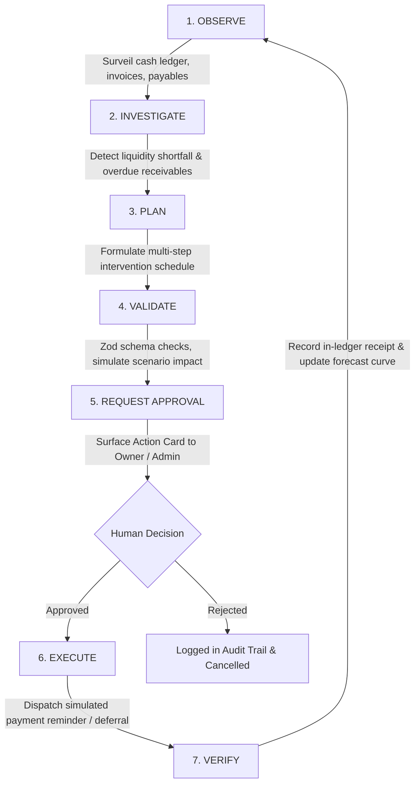

# LEDGER ZERO – System Architecture & Design Specification

**NULL PROTOCOL** • *From Financial Insight to Real-World Action*

---

## 1. System Overview & The Core Loop

LEDGER ZERO is an autonomous AI financial operating system engineered specifically for small businesses. Rather than operating merely as a conversational advisor, LEDGER ZERO executes an auditable, governed autonomy loop:



---

## 2. Layered Architecture

```
┌─────────────────────────────────────────────────────────────┐
│                    Next.js App Router UI                    │
│   Overview • AI Workspace • Action Center • Cash Flow Sim   │
│   Transactions • Invoices • Receivables • Payables • Team   │
└──────────────────────────────┬──────────────────────────────┘
                               │
                               ▼
┌─────────────────────────────────────────────────────────────┐
│                   Domain & Contracts Layer                   │
│   src/domain/types.ts (Zod schemas & TypeScript types)      │
│   src/services/contracts.ts (Abstract service interfaces)   │
└──────────────────────────────┬──────────────────────────────┘
                               │
               ┌───────────────┴───────────────┐
               ▼                               ▼
┌─────────────────────────────┐ ┌─────────────────────────────┐
│      Mock Service Layer     │ │       API Service Layer     │
│   (Active by default)       │ │   (NEXT_PUBLIC_DATA_MODE=   │
│  - In-memory store          │ │    api)                     │
│  - LocalStorage persistence │ │  - Typed REST client stubs  │
│  - Deterministic simulator  │ │  - Direct backend adapter   │
└──────────────┬──────────────┘ └──────────────┬──────────────┘
               │                               │
               └───────────────┬───────────────┘
                               │
                               ▼
┌─────────────────────────────────────────────────────────────┐
│            Pure Financial Engine (src/lib/finance/)         │
│   - Cash position calculation (confirmed transactions)      │
│   - 7 & 30-day deterministic liquidity forecast             │
│   - Aging buckets (Current, 1-30, 31-60, 61-90, 90+)        │
│   - Scenario simulation (non-mutating overlay)              │
│   - Zero floating-point drift (integer minor units)         │
└─────────────────────────────────────────────────────────────┘
```

---

## 3. Swap-Ready Data Layer

The application UI has **zero direct coupling** to mock stores or external APIs. All data and operational interactions occur through the abstract interfaces in `src/services/contracts.ts`:

- `DataService`: Queries balances, records transactions, manages invoices, budgets, and counterparties.
- `AgentService`: Accepts goals, streams step-by-step progress events, and emits tool calls.
- `ActionService`: Enforces action lifecycle (`pending_approval` → `approved` → `executing` → `completed`).
- `ReminderService`: Drafts and logs simulated collection notices.
- `AuthService`: Manages team identity and active permission roles.

### How to Switch to Real Backend:
1. Set `NEXT_PUBLIC_DATA_MODE=api` in `.env.local`.
2. Set `NEXT_PUBLIC_API_URL=https://api.yourdomain.com/v1`.
3. The frontend immediately points to the REST endpoints detailed in `docs/BACKEND_CONTRACT.md`.

---

## 4. Deterministic Financial Engine Rules

### Integer Minor Units & Universal Currencies
All financial numbers are strictly stored as integer minor units:
- USD: 2 decimals (`$20,000.00` = `2000000`)
- BDT: 2 decimals (`৳1,500.00` = `150000`)
- JPY: 0 decimals (`¥50,000` = `50000`)
- KWD: 3 decimals (`KD 1,250.125` = `1250125`)

Formatting is handled via `Intl.NumberFormat` with tabular figures enabled (`font-variant-numeric: tabular-nums`).

### Double-Counting Prevention
- **Confirmed Cash:** Strictly calculated from settled transactions + opening cash balance.
- **Receivables & Payables:** Strictly calculated from unsettled invoices (`totalAmount - amountPaid`).
- **Payment Settlements:** Recording an invoice payment creates a matching settled cash transaction and simultaneously decrements the invoice's outstanding balance, guaranteeing that money is never counted twice.
- **Forecast Curves:** Cash on day `t` is `Cash(t-1) + InflowsDue(t) - OutflowsDue(t)`. Unsettled invoices already past due at reference date are grouped conservatively on Day 0.

---

## 5. Scripted Agent Simulator

The client-side `AgentService` faithfully mirrors the asynchronous event stream of a production LLM agent:

1. **Goal Reception:** Parses user intention into one of 4 specialized financial intents:
   - `cash_shortage`
   - `overdue_collections`
   - `expense_review`
   - `scenario_simulation`
2. **Streaming Protocol:** Dispatches typed events with realistic delays:
   - `goal_received` → `plan_created` → `tool_call_start` → `tool_call_result` → `evidence_found` → `draft_produced` → `approval_requested`.
3. **Zod Tool Validation:** All simulated tool inputs and outputs are validated against Zod schemas. Invalid arguments fail gracefully and emit `tool_call_error`.
4. **Mandatory Approval Prerequisite:** The service layer strictly throws an exception if `executeActionTask` is invoked on any task that is not in the `approved` state.
